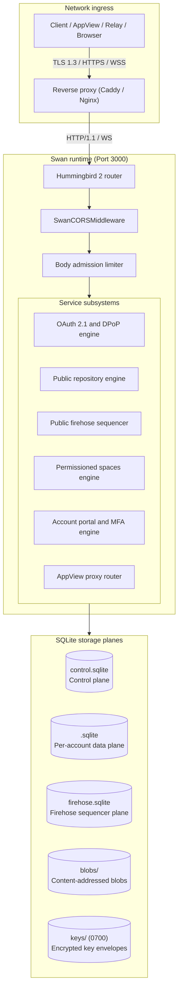
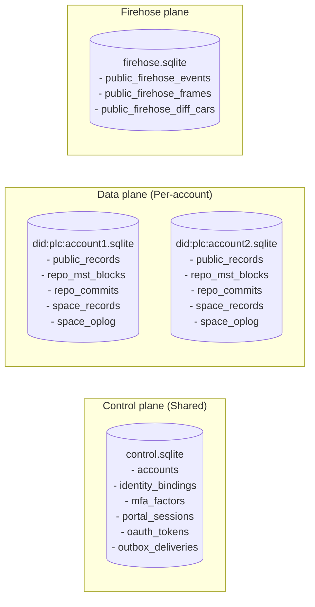

# Swan architecture

Swan is a Swift-native AT Protocol Personal Data Server (PDS) and permissioned-data server. It is built with Swift 6 and Swift Concurrency, running on the Hummingbird 2 server framework on top of SwiftNIO.

## Library target structure

Swan's codebase is divided into modular Swift Package Manager library targets, each with a defined boundary and responsibility:

- `SwanCore`: Core cryptographic primitives (SHA-256, BLAKE3, K-256, P-256), base data structures, error types, logging configuration, and fundamental domain protocols.
- `SwanSpacesWire`: Typed wire models and lexicon definitions for permissioned spaces (`com.atproto.space.*` and `com.atproto.simplespace.*`), generated from AT Protocol lexicons via Petrel.
- `SwanPublicWire`: Wire models, query parameter decoders, and response serializers for public AT Protocol repository endpoints and sync interfaces.
- `SwanPublicRepository`: Merkle Search Tree (MST) implementation, CBOR-encoded records with CIDv1 addressing, signed commit trees, and CAR v1 archive packing and slicing.
- `SwanPublicFirehose`: Firehose event sequencer, stream frame encoding (`#commit`, `#sync`, `#identity`, `#account`, `#info`), minimal diff CAR packaging, and subscriber connection budgeting.
- `SwanPublicRelayVerifier`: Verification and ingestion logic for public relay events and synchronization streams.
- `SwanSpaces`: Permissioned data and spaces engine, LtHash16 cryptographic accumulator, capability delegations, space oplogs, reader-bound commit verification, and durable outbox delivery.
- `SwanStorage`: Abstract storage protocols and interfaces defining the contracts for repositories, spaces, credentials, replay guards, WebAuthn challenges, and audit logs.
- `SwanSQLite`: SQLite backend implementation using SQLiteNIO, managing write-ahead logging (WAL), foreign keys, microsecond transactions, compare-and-swap (CAS) updates, and queries across the three database planes.
- `SwanAccounts`: Account lifecycle management, Argon2id and bcrypt password hashing, `did:web` and `did:plc` identity resolution, and multi-factor authentication (TOTP RFC 6238, WebAuthn/FIDO2 passkeys, recovery codes, step-up tokens, and audit event emission).
- `SwanAccountExport`: Account export bundle generation, CAR archive creation, and metadata packaging.
- `SwanOAuth`: OAuth 2.1 authorization server implementing Pushed Authorization Requests (PAR, RFC 9126), Proof Key for Code Exchange (PKCE, RFC 7636), Demonstrating Proof-of-Possession (DPoP, RFC 9449), private_key_jwt client authentication (RFC 7523), token lifecycle, and scope resolution.
- `SwanHTTP`: Hummingbird 2 HTTP and WebSocket server runtime, router assembly, CORS middleware, request body admission limiters, XRPC handlers, OAuth endpoints, Account Portal asset serving, and AppView proxying.
- `SwanInterop`: Interoperability test matrix, conformance test runners, and multi-implementation verification harnesses.
- `swan`: Command-line executable providing eight subcommands: `serve`, `account`, `export`, `backup`, `restore`, `verify`, `lab`, and `firehose`.

## Hummingbird 2 runtime

Swan uses Hummingbird 2 on top of SwiftNIO to handle asynchronous, non-blocking HTTP and WebSocket traffic with Swift 6 structured concurrency.

- **Immutable router assembly:** Routes and middleware stacks are assembled during startup in `SwanHTTP.buildRouter()`. Once the `Application` instance is created, route additions are disallowed.
- **CORS middleware precedence:** `SwanCORSMiddleware` sits as the first middleware on the router, ensuring that `OPTIONS` preflight requests for any path receive correct CORS headers before reaching route handlers.
- **Bounded request body admission:** `SwanRequestBodyAdmissionConfiguration` enforces strict size ceilings on incoming request bodies (16 KiB default for JSON payloads, 2 MiB for public blobs) to prevent denial-of-service attacks from unbounded memory allocation.
- **Graceful service lifecycle:** Background services (including the firehose sequencer, retention reaper, and outbox dispatcher) integrate with Swift Service Lifecycle. On receiving `SIGTERM` or `SIGINT`, the runtime stops accepting new connections, allows in-flight database transactions to drain, and shuts down network listeners cleanly.

## Storage planes

Swan divides persistent storage across three distinct database planes, content-addressed blob storage, and an encrypted key directory:

- **`control.sqlite` (Control plane):** Stores global server state, including account identities (DIDs, handles), password hashes (Argon2id/bcrypt), MFA factor records, active OAuth client metadata, portal sessions, and cross-account delivery outboxes.
- **`<did>.sqlite` (Per-account data plane):** Each account has a dedicated SQLite database named after its canonical DID (for example, `did:plc:12345678.sqlite`). This file contains the account's public repository records, Merkle Search Tree (MST) nodes, signed commits, private space records, and space oplogs.
- **`firehose.sqlite` (Firehose sequencer plane):** Stores the monotonic public event sequence, event frames, and diff CAR slices.
- **`blobs/` (Content-addressed storage):** Stores repository and space blobs addressed by their cryptographic hashes.
- **`keys/` (Key envelope directory):** Protected directory with `0700` filesystem permissions holding AES-GCM encrypted key envelopes (such as repository signing keys and TOTP secret encryption keys).

All databases operate in SQLite Write-Ahead Logging (WAL) mode with `PRAGMA synchronous = NORMAL` and `PRAGMA foreign_keys = ON`. Transactions are kept short, and network I/O is prohibited while holding SQLite locks. Compare-and-swap (CAS) operations protect against lost updates during concurrent mutations.

## OAuth 2.1 and DPoP authorization model

Swan provides an OAuth 2.1 authorization server with mandatory sender-constrained tokens via DPoP (RFC 9449):

- **Pushed Authorization Requests (PAR, RFC 9126):** Clients must submit authorization parameters to `/oauth/par` before directing the user agent to `/oauth/authorize`. Authorization parameters in query strings are rejected.
- **Sender-constrained tokens (RFC 9449):** Access and refresh tokens are bound to the client's public key using ES256 DPoP proofs. Bearer tokens intercepted in transit cannot be replayed from other endpoints.
- **Server nonce rotation:** Swan issues and rotates server nonces to guard against proof replay attacks.
- **Private Key JWT client authentication (RFC 7523):** Confidential clients authenticate using signed client assertions.
- **Dynamic client metadata discovery:** Client metadata is fetched over HTTPS from client ID URLs with strict SSRF defenses blocking private and loopback IP addresses.
- **Scope resolution:** Swan parses and validates fine-grained scopes including `atproto`, `include:<nsid>`, `space:<type>`, and collection-scoped permissions against lexicon definitions.

For details on the interactive sign-in pages, authorization consent flows, inlined daisyUI stylesheets, and runtime CSP hash derivation, see [Server surfaces](server-surfaces.md).

## Public repository and firehose engine

The public repository subsystem implements the AT Protocol data repository model with cryptographic verification and real-time streaming:

- **Deterministic Merkle Search Tree (MST):** Records are indexed in a deterministic binary key-path trie with CBOR encoding, enabling inclusion/exclusion proofs and compact CAR archive extraction.
- **Secp256k1 commit signing:** Every repository commit is cryptographically signed by the account's repository key (K-256 / `ES256K`) and verified against the account's DID document or PLC directory history.
- **Monotonic sequencer:** Events (`#commit`, `#sync`, `#identity`, `#account`, `#info`) receive continuous 64-bit integer sequence IDs stored in `firehose.sqlite`.
- **Diff CAR packaging:** Firehose commit events deliver minimal diff CAR slices containing only newly added or modified blocks over `/xrpc/com.atproto.sync.subscribeRepos`.
- **Subscriber admission budgeting:** Connection quotas allocate 75% of capacity for standard API traffic and reserve 25% for firehose WebSocket consumers (`PublicFirehoseSubscriberAdmission`).
- **Retention reaper:** Background worker automatically removes expired firehose entries according to configured age, row count, or byte size limits.

For details on `com.atproto.identity.resolveHandle` and foreign handle resolution across external DNS and HTTPS endpoints, see [Server surfaces](server-surfaces.md).

## Multi-factor authentication and step-up subsystem

Swan integrates multi-factor authentication into account management and OAuth authorization workflows:

- **WebAuthn and FIDO2 passkeys:** Supports hardware security keys and platform biometrics via W3C WebAuthn Level 3. Registration and assertion verify ES256/P-256 COSE keys, exact HTTPS origin, RP ID hash, client data type, challenge binding, user presence (UP), user verification (UV), and monotonic signature counters in atomic SQLite transactions.
- **TOTP (RFC 6238):** Standard time-based one-time passwords supporting SHA-1, SHA-256, and SHA-512 with 6 or 8 digits and single-step drift windows. Includes constant-time comparison, per-account replay CAS guards, and AES-GCM encrypted secret envelopes.
- **Backup recovery codes:** High-entropy single-use recovery codes stored exclusively as salted Argon2id or SHA-256 digests.
- **Step-up authentication:** Sensitive operations (such as credential updates, app password creation, data export, and account deletion) require fresh re-authentication, issuing short-lived, single-use `stepUpReceipt` tokens bound to the active session.
- **Redacted audit logging:** All MFA operations emit structured `MFAAuditEvent` records. Plaintext passwords, TOTP codes, recovery codes, WebAuthn challenge bytes, and signature payloads are excluded from logs.

## Permissioned spaces engine

Swan's permissioned-data plane provides structured, multi-party collaboration spaces without publishing sensitive records to the public firehose:

- **LtHash cryptographic accumulator:** Uses additively homomorphic hashing (LtHash16) to maintain an incremental commitment over repository state.
- **Reader-bound commit signatures:** Commit signatures bind the space author, space identifier, revision, and reader context, preventing unauthorized distribution.
- **Capability delegations and space credentials:** Space authorities issue short-lived delegation tokens that are exchanged for read-only space credentials.
- **Durable outbox delivery:** Peer-pinned notification workers ensure at-least-once notification delivery to remote space members across network disruptions and service restarts.

## AppView proxying and external surfaces

Swan handles legacy client compatibility and upstream AT Protocol proxying:

- **Scoped app passwords:** Clients that do not support OAuth 2.1 can authenticate via `com.atproto.server.createSession` using scoped, revocable app passwords.
- **Upstream AppView routing:** Read queries for AppView namespaces (`app.bsky.*`) are proxied upstream to the configured AppView using minted service-auth JWTs.
- **Destination routing via `atproto-proxy`:** When the client provides an `atproto-proxy` header, the proxy resolves the target service endpoint and forwards requests in allowed namespaces (`app.bsky.*`, `chat.bsky.*`, `tools.ozone.*`).

For full details on the XRPC proxy router, namespace admission rules, the SvelteKit Account Management Portal, and operator diagnostics, see [Server surfaces](server-surfaces.md).
