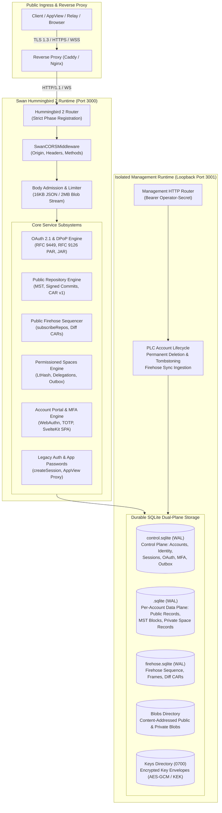
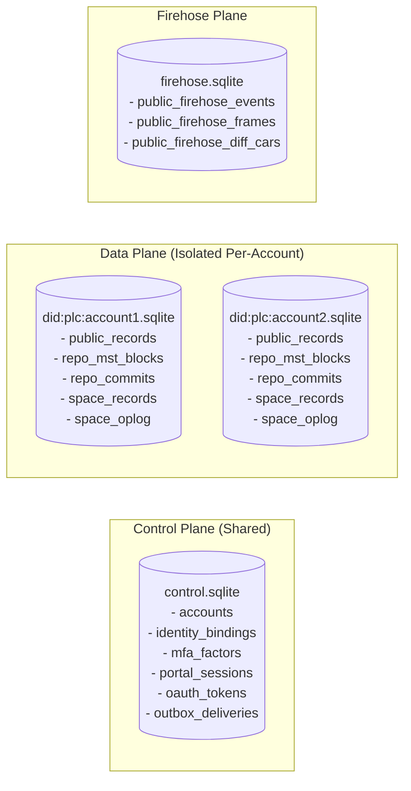
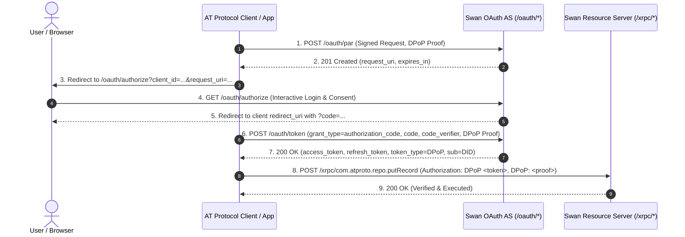
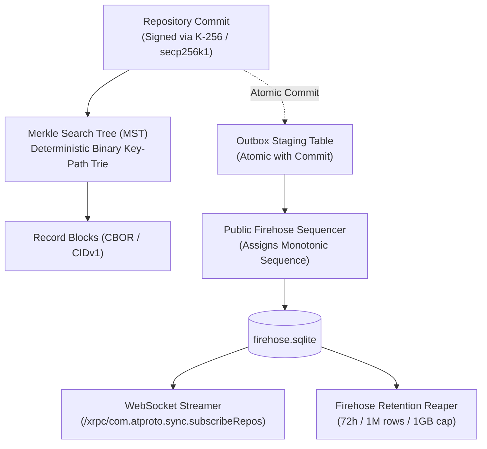
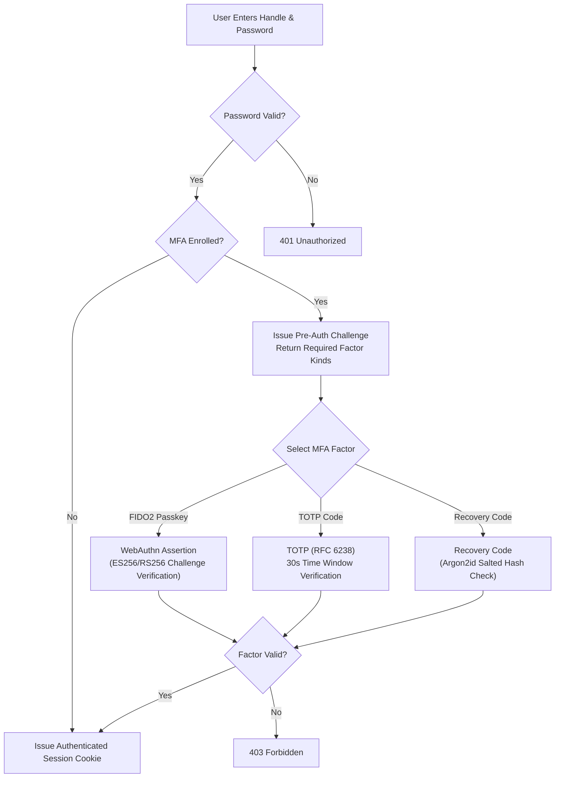

# Swan Modular Architecture & Component Overview

Swan is a Swift-native AT Protocol Personal Data Server (PDS) and permissioned-data interoperability engine built for extreme protocol fidelity, cryptographic correctness, strict data isolation, and crash resilience. It is developed on Swift 6 with Swift Concurrency and runs on the Hummingbird 2 server framework.

---

## 1. Hummingbird 2 Server Runtime

Swan uses **Hummingbird 2** on top of **SwiftNIO** to achieve asynchronous, non-blocking HTTP and WebSocket processing with deterministic memory management and Swift 6 structured concurrency.

### Key Architectural Invariants
1. **Immutable Route Assembly:** Hummingbird 2 bakes middleware stacks and route handlers into the routing tree during startup. All routes must be registered before the `Application` instance is created (`SwanHTTP.buildRouter()`). Route additions after initialization are strictly forbidden and rejected.
2. **CORS Middleware Precedence:** `SwanCORSMiddleware` is attached as the very first middleware on the router. This guarantees that `OPTIONS` preflight requests for any registered path or 404 fallback receive proper CORS headers without falling into unhandled route exceptions.
3. **Bounded Request Body Admission:** All HTTP JSON write bodies are gated by `SwanRequestBodyAdmissionConfiguration` with strict size ceilings (16 KiB default for JSON payloads, 2 MiB for public blobs) to eliminate Denial of Service (DoS) attack vectors via unconstrained allocations.
4. **Graceful Service Lifecycle:** Background tasks (such as firehose sequencers, retention reapers, did:web revalidation workers, and SMTP outbox dispatchers) conform to `Service` or `CustomStringConvertible` lifecycle actors. When `SIGTERM` or `SIGINT` is received, the server stops accepting new connections, allows in-flight SQLite transactions to drain, and gracefully closes network listeners.

---

## 2. SQLite Dual-Plane Storage Architecture

Swan enforces a strict separation between the **control plane** and the **data plane** to isolate account metadata from repository data.

### Storage Principles
- **`control.sqlite`:** Owns global state including account identities (DIDs, handles), password hashes (Argon2id/bcrypt), MFA credentials, active OAuth client registrations, browser sessions, and cross-account delivery outboxes.
- **`<did>.sqlite`:** Every account has its own SQLite database file named after its canonical DID (e.g. `did:plc:12345678.sqlite`). It contains the user's public repository records, Merkle Search Tree (MST) nodes, signed commits, and private space operations.
- **`firehose.sqlite`:** Dedicated sequencer database storing the continuous monotonic event stream, event frames, and diff CARs.
- **Write-Ahead Logging (WAL):** All SQLite databases operate strictly in `WAL` mode with `PRAGMA synchronous = NORMAL` and `PRAGMA foreign_keys = ON`.
- **No Network I/O Inside Transactions:** Database transactions are kept microsecond-short. Network requests (PLC resolution, SMTP sends, OAuth JWKS fetches) are **never** executed while a SQLite transaction lock is held.
- **Compare-And-Swap (CAS) Correctness:** Mutations to repositories and sequences require explicit revision/CID compare-and-swap checks, preventing lost updates under concurrency.

---

## 3. OAuth 2.1 & DPoP Sender-Constrained Subsystem

Swan implements an OAuth 2.1 authorization server with mandatory sender-constraining via **DPoP (Demonstrating Proof-of-Possession at the Application Layer, RFC 9449)**.

### Security & Protocol Features
- **Mandatory PAR (RFC 9126):** Clients must push authorization parameters to `/oauth/par` before directing the user agent to `/oauth/authorize`. Authorization parameters in query strings are rejected.
- **Sender-Constrained Tokens (RFC 9449):** Access and refresh tokens are bound to the client's ephemeral public key via DPoP proofs (using ES256). Intercepted bearer tokens cannot be replayed from other endpoints.
- **Server Nonce Enforcement:** Swan issues and rotates high-entropy server nonces to protect against proof replay.
- **Private Key JWT Client Authentication (RFC 7523):** Confidential clients authenticate using client assertions signed with their registered keys.
- **Dynamic Client Metadata Discovery:** Client configurations are fetched securely over HTTPS from `client_id` URLs with strict loopback/private IP blocking to prevent Server-Side Request Forgery (SSRF).
- **Fine-Grained Scope Resolution:** Supports `atproto`, `include:<nsid>`, `space:<type>`, and collection-scoped permissions with cryptographic lexicon validation.

---

## 4. Public Firehose & Repository Engine

The public repository engine is a complete, native AT Protocol repository implementation featuring Merkle Search Trees (MST) and real-time streaming.

### Engine Components
- **Deterministic MST:** Records are organized in deterministic CBOR-encoded Merkle Search Trees, enabling cryptographic proof of inclusion/exclusion and compact CAR generation.
- **Secp256k1 Commit Signing:** Every commit is cryptographically signed by the account's repository signing key, verifiable against the account's DID document or PLC directory history.
- **Monotonic Sequencer:** Events (`#commit`, `#sync`, `#identity`, `#account`, `#info`) receive contiguous, gap-free 64-bit integer sequence IDs stored in `firehose.sqlite`.
- **Diff CAR Packaging:** Firehose commit events carry minimal diff CAR slices containing only newly created/modified blocks, minimizing network overhead.
- **Subscriber Connection Budgeting:** Connection quotas reserve 75% of available capacity for standard API calls and assign a dedicated 25% quota for firehose WebSocket consumers (`PublicFirehoseSubscriberAdmission`).
- **Configurable Retention Reaper:** Automatically reaps expired firehose entries based on age (default: 72h), row count (default: 1,000,000), or byte limits (default: 1 GiB).

---

## 5. MFA & WebAuthn / Passkey Subsystem

Swan provides enterprise-grade multi-factor authentication built directly into the account portal and OAuth authorization workflows.

### Supported Factor Kinds
1. **WebAuthn / FIDO2 Passkeys:** Hardware security keys (YubiKey, Apple Touch ID/Face ID, Windows Hello) using standard W3C WebAuthn Level 3 assertions.
2. **TOTP (RFC 6238):** Standard time-based one-time passwords with SHA-1 HMAC and 30-second windows.
3. **Backup Recovery Codes:** Salted and cryptographically hashed one-time recovery codes for account salvage.
4. **Step-Up Authentication:** High-risk actions (modifying credentials, generating app passwords, account deletion) require interactive re-authentication or biometric step-up challenges resulting in single-use `stepUpReceipt` tokens.

---

## 6. SvelteKit Static Portal & Management Service

Swan includes an integrated account management interface built with SvelteKit.

- **Static Pre-Rendering:** The account portal is compiled into zero-dependency static assets located at `/usr/local/share/swan/account` (or configurable via `--account-portal-directory`).
- **Hummingbird Asset Handler:** Hummingbird serves `/account/**` SPA routes with secure headers (`Content-Security-Policy`, `X-Content-Type-Options`, `X-Frame-Options`).
- **Session Security:**
  - `__Host-swan-session`: `HTTPOnly`, `Secure`, `SameSite=Lax` cookie storing cryptographically signed session identifiers.
  - `__Host-swan-csrf`: Anti-CSRF token validated via double-submit header checks (`X-Swan-CSRF`).
  - Strict pre-auth isolation prevents unauthenticated users from accessing any account data before factor verification.

---

## 7. Permissioned Data / Spaces Subsystem

Swan's permissioned-data plane provides structured collaboration spaces with cryptographic auditability without placing sensitive data into the public AT Protocol firehose.

- **LtHash Cryptographic Accumulator:** Uses additively homomorphic hashing (LtHash16) to maintain an incremental commitment over repository state.
- **Reader-Bound Commits:** Commit signatures bind the space author, space identifier, revision, and reader context.
- **Delegation & Space Credentials:** Space authorities issue short-lived, single-use delegation tokens that are exchanged for read-only space credentials.
- **Durable Outbox Delivery:** Peer-pinned notification workers ensure at-least-once notification delivery to remote space members and authorities across network interruptions and daemon restarts.

---

## 8. AppView Proxying & Scoped App Passwords

- **Legacy App Passwords:** Enables third-party AT Protocol clients that do not yet support OAuth 2.1 to authenticate via `com.atproto.server.createSession` using scoped, revocable app passwords.
- **Transparent AppView Proxying:** Unmatched `app.bsky.*` read queries are proxied upstream to the official Bluesky AppView (`https://api.bsky.app`) with minted service-auth JWTs, providing complete feed and social graph access out of the box.
