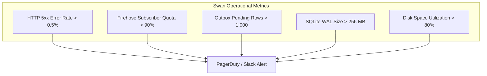
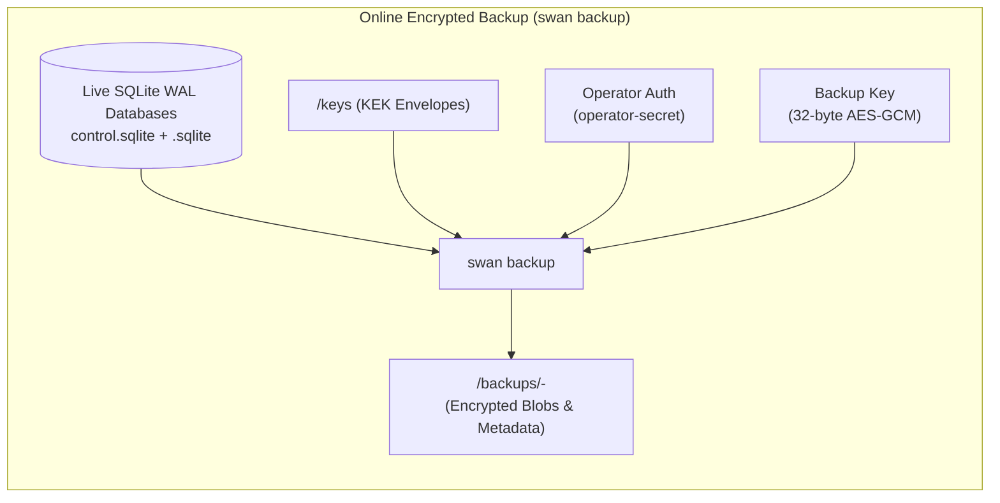

# Swan Operational Runbook & Disaster Recovery

This operational runbook provides procedures for maintaining health, executing backups and restores, rotating cryptographic secrets, performing database maintenance, and handling disaster recovery scenarios on a production Swan PDS.

---

## 1. Health Monitoring & Metrics

### Health & Readiness Endpoints
Swan exposes multiple health check endpoints for load balancers, orchestrators, and external monitors:

| Endpoint | Method | Success | Response | Purpose |
|---|---|---|---|---|
| `/health` | `GET` | `200 OK` | `OK` (text/plain) | Liveness probe. Verifies Hummingbird event loop and HTTP listener are responding. |
| `/.well-known/did.json` | `GET` | `200 OK` | JSON DID Document | Service identity probe. Validates server identity resolution. |
| `/xrpc/com.atproto.server.describeServer` | `GET` | `200 OK` | JSON Description | Capability probe. Validates profile and route surface loading. |
| `/xrpc/community.lexicon.service.describe` | `GET` | `200 OK` | JSON Description | Lexicon method discovery probe. Returns all supported XRPC NSIDs. |

### Monitoring Health Probes via curl
```bash
# Basic Liveness Check
curl -sS -f http://127.0.0.1:3000/health

# Verify Server Description & Protocol Profile
curl -sS -f http://127.0.0.1:3000/xrpc/com.atproto.server.describeServer | jq .

# Verify Supported Lexicons
curl -sS -f http://127.0.0.1:3000/xrpc/community.lexicon.service.describe | jq .methods
```

### Key Performance Indicators (KPIs) & Alerting Rules



1. **HTTP 5xx Error Rate:** Any sustained rate of HTTP 500 or 503 errors indicates database locks, unhandled runtime faults, or missing signing keys. Alert if 5xx exceeds 0.5% over 5 minutes.
2. **Firehose Connection Saturation:** Swan reserves 25% of `--max-connections` for anonymous firehose subscribers. If firehose subscribers reach 100% of their allocation (64 connections on default 256 budget), new subscribers will receive `429 Too Many Requests` or `503 Service Unavailable`.
3. **Outbox Stalling:** The `outbox_deliveries` table in `control.sqlite` should drain rapidly. If pending rows exceed 1,000 or oldest pending item is > 15 minutes old, alert on outbound network or SMTP blockage.
4. **SQLite WAL Bloat:** WAL files (`control.sqlite-wal`, `<did>.sqlite-wal`) should rarely exceed 64 MiB under normal checkpointing. A WAL file growing beyond 256 MiB indicates long-running read transactions or failed checkpoints.

---

## 2. Backup & Restore Procedures

Swan supports two complementary backup workflows:
1. **Operator Encrypted Account Backup (`swan backup`):** Cryptographically authenticated, sealed snapshot of an individual account's data, private key envelopes, and public repository state.
2. **Full System Snapshot:** Atomic filesystem or SQLite snapshot for host-level disaster recovery.



### Procedure A: Encrypted Account Backup (`swan backup`)

Execute an online, non-blocking backup for an active account DID:

```bash
#!/usr/bin/env bash
set -euo pipefail

DATA_DIR="/var/lib/swan/data"
SECRETS_DIR="/etc/swan/secrets"
BACKUP_ROOT="/var/backups/swan"
ACCOUNT_DID="did:plc:12345678abcdefgh"
TIMESTAMP="$(date -u +%Y%m%d_%H%M%SZ)"
TARGET_DIR="${BACKUP_ROOT}/${ACCOUNT_DID}_${TIMESTAMP}"

# Ensure backup key exists (32-byte base64url)
BACKUP_KEY_FILE="${SECRETS_DIR}/operator-backup-key"
if [ ! -f "${BACKUP_KEY_FILE}" ]; then
  echo "Generating new operator backup key..."
  openssl rand -base64 32 | tr '+/' '-_' | tr -d '=' | tr -d '\n' > "${BACKUP_KEY_FILE}"
  chmod 0600 "${BACKUP_KEY_FILE}"
fi

mkdir -p "${BACKUP_ROOT}"

echo "Running backup for ${ACCOUNT_DID} into ${TARGET_DIR}..."

swan backup \
  --data-directory "${DATA_DIR}" \
  --did "${ACCOUNT_DID}" \
  --output-directory "${TARGET_DIR}" \
  --operator-secret-file "${SECRETS_DIR}/operator-secret" \
  --account-kek-file "${SECRETS_DIR}/account-kek" \
  --backup-key-file "${BACKUP_KEY_FILE}" \
  --account-kek-id "primary"

echo "Backup complete and verified."
```

### Procedure B: Encrypted Account Restore (`swan restore`)

To restore an account from an operator backup into a new or recovered data directory:

```bash
#!/usr/bin/env bash
set -euo pipefail

DATA_DIR="/var/lib/swan/data"
SECRETS_DIR="/etc/swan/secrets"
BACKUP_INPUT_DIR="/var/backups/swan/did:plc:12345678abcdefgh_20260817_140000Z"
BACKUP_KEY_FILE="${SECRETS_DIR}/operator-backup-key"

echo "Restoring account from ${BACKUP_INPUT_DIR} into ${DATA_DIR}..."

swan restore \
  --data-directory "${DATA_DIR}" \
  --input-directory "${BACKUP_INPUT_DIR}" \
  --operator-secret-file "${SECRETS_DIR}/operator-secret" \
  --backup-key-file "${BACKUP_KEY_FILE}" \
  --account-kek-file "${SECRETS_DIR}/account-kek" \
  --account-kek-id "primary"

echo "Account restoration succeeded."
```

### Procedure C: Full SQLite Hot-Backup via `VACUUM INTO`

For automated whole-node disaster recovery backups while Swan is running:

```bash
#!/usr/bin/env bash
set -euo pipefail

DATA_DIR="/var/lib/swan/data"
BACKUP_DEST="/var/backups/swan_full_$(date +%Y%m%d_%H%M%S)"
mkdir -p "${BACKUP_DEST}"

# 1. Backup control plane database safely
sqlite3 "${DATA_DIR}/control.sqlite" "VACUUM INTO '${BACKUP_DEST}/control.sqlite';"

# 2. Backup firehose database safely
if [ -f "${DATA_DIR}/firehose.sqlite" ]; then
  sqlite3 "${DATA_DIR}/firehose.sqlite" "VACUUM INTO '${BACKUP_DEST}/firehose.sqlite';"
fi

# 3. Backup all per-account databases
for db in "${DATA_DIR}"/did:*.sqlite; do
  [ -f "$db" ] || continue
  filename="$(basename "$db")"
  sqlite3 "$db" "VACUUM INTO '${BACKUP_DEST}/${filename}';"
done

# 4. Copy key envelopes and blobs (hardlinks or copy)
cp -a "${DATA_DIR}/keys" "${BACKUP_DEST}/keys"
cp -a "${DATA_DIR}/blobs" "${BACKUP_DEST}/blobs" 2>/dev/null || true

echo "Full node backup created at ${BACKUP_DEST}"
```

---

## 3. Cryptographic Key Rotation Procedures

### Procedure A: Account Key Encryption Key (KEK) Rotation
The Account KEK protects per-account private key envelopes stored in `<data-directory>/keys/`. To rotate the KEK:

1. **Generate New KEK:**
   ```bash
   gen_b64url() { openssl rand -base64 32 | tr '+/' '-_' | tr -d '='; }
   gen_b64url > /etc/swan/secrets/account-kek-v2
   chmod 0600 /etc/swan/secrets/account-kek-v2
   ```
2. **Re-encrypt Key Envelopes:**
   Run the offline envelope migration utility to decrypt envelopes with `primary` and re-encrypt under `v2`:
   ```bash
   swan account re-encrypt-keys \
     --data-directory /var/lib/swan/data \
     --old-kek-file /etc/swan/secrets/account-kek \
     --old-kek-id primary \
     --new-kek-file /etc/swan/secrets/account-kek-v2 \
     --new-kek-id v2 \
     --operator-secret-file /etc/swan/secrets/operator-secret
   ```
3. **Update Daemon Configuration:**
   Point `--public-account-kek-file` and other KEK flags to `/etc/swan/secrets/account-kek-v2` with ID `v2`, then restart Swan:
   ```bash
   sudo systemctl restart swan
   ```

### Procedure B: OAuth Server Key Rotation
The `oauth-server-key` encrypts user browser sessions and DPoP-bound refresh tokens.

> [!WARNING]
> Rotating the `oauth-server-key` will invalidate existing active browser portal sessions and active OAuth refresh tokens, requiring users and third-party apps to re-authenticate.

1. Generate the new key:
   ```bash
   openssl rand -base64 32 | tr '+/' '-_' | tr -d '=' | tr -d '\n' > /etc/swan/secrets/oauth-server-key.new
   chmod 0600 /etc/swan/secrets/oauth-server-key.new
   ```
2. Atomically swap the secret file:
   ```bash
   mv /etc/swan/secrets/oauth-server-key.new /etc/swan/secrets/oauth-server-key
   ```
3. Gracefully reload Swan:
   ```bash
   sudo systemctl restart swan
   ```

### Procedure C: PLC Account Key Rotation (`rotate-plc`)
When rotating an account's PLC signing or recovery key:

```bash
swan account rotate-plc \
  --data-directory /var/lib/swan/data \
  --did "did:plc:12345678abcdefgh" \
  --plc-origin "https://plc.directory" \
  --operator-secret-file /etc/swan/secrets/operator-secret \
  --account-kek-file /etc/swan/secrets/account-kek \
  --account-kek-id "primary"
```

---

## 4. Database Maintenance & Tuning

### WAL Maintenance & Checkpointing
SQLite WAL files should be periodically checkpointed and truncated to reclaim disk space:

```bash
#!/usr/bin/env bash
# Run nightly via cron or systemd timer
DATA_DIR="/var/lib/swan/data"

for db in "${DATA_DIR}"/*.sqlite; do
  [ -f "$db" ] || continue
  echo "Checkpointing $db..."
  sqlite3 "$db" "PRAGMA wal_checkpoint(TRUNCATE);"
done
```

### Database Integrity Verification
Run periodic integrity checks across all control and account databases:

```bash
#!/usr/bin/env bash
set -euo pipefail
DATA_DIR="/var/lib/swan/data"

echo "Checking SQLite database integrity..."
for db in "${DATA_DIR}"/*.sqlite; do
  [ -f "$db" ] || continue
  echo "Checking $db..."
  result=$(sqlite3 "$db" "PRAGMA integrity_check; PRAGMA foreign_key_check;")
  if [ "$result" != "ok" ]; then
    echo "ERROR: Integrity check failed on $db: $result" >&2
    exit 1
  fi
done
echo "All databases passed integrity checks."
```

### Manual Firehose Sequence Compaction
If `firehose.sqlite` grows excessively before the retention reaper runs:

```bash
swan firehose prune \
  --data-directory /var/lib/swan/data \
  --retention-age-hours 48 \
  --retention-max-rows 500000 \
  --operator-secret-file /etc/swan/secrets/operator-secret
```

---

## 5. Offline Recovery & Account Migrations

### Rebuilding Merkle Search Trees (MST)
If an account's local SQLite database suffers record corruption but has verified CAR commits or relay snapshots:

```bash
swan lab import-public \
  --remote-url https://relay.example.com \
  --data-directory /var/lib/swan/data \
  --did did:plc:12345678abcdefgh \
  --commit-key-algorithm secp256k1 \
  --resolve-commit-key \
  --promote-public-blobs \
  --output /tmp/recovery-report.json
```

### Permanent Account Deletion & PLC Tombstoning
To permanently destroy an account, delete its private SQLite database and key envelopes, and submit an authenticated tombstone operation to the PLC directory:

```bash
swan account delete \
  --data-directory /var/lib/swan/data \
  --did did:plc:12345678abcdefgh \
  --tombstone-reason "User requested GDPR erasure" \
  --plc-origin "https://plc.directory" \
  --operator-secret-file /etc/swan/secrets/operator-secret \
  --account-kek-file /etc/swan/secrets/account-kek \
  --account-kek-id "primary"
```
