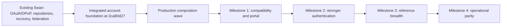

# Swan Account Program Master-Resolution Implementation Plan

> **For agentic workers:** REQUIRED SUB-SKILL: Use superpowers:subagent-driven-development (recommended) or superpowers:executing-plans to implement this plan task-by-task. Steps use checkbox (`- [ ]`) syntax for tracking.

**Goal:** Make Swan a self-service, reference-compatible PDS with stronger account security while preserving Swan's existing OAuth/DPoP, repository, permissioned-data, and federation security boundaries.

**Architecture:** Hummingbird remains the sole production application runtime. A static SvelteKit portal is an account client, not a second backend; all durable authority stays in Swift/SQLite services with separate OAuth, legacy, app-password, and management-session authorization contexts.

**Tech Stack:** Swift 6.1, Hummingbird 2, SQLiteNIO, Swift Crypto/CryptoKit, NIO TLS, SvelteKit `adapter-static`, TypeScript, Playwright, Docker, jj workspaces.

**Spec:** `docs/superpowers/specs/2026-08-16-swan-account-identity-reference-parity-design.md`

## Global Constraints

- OAuth tokens remain DPoP-bound; no account-program work converts them to bearer tokens.
- Management cookies authenticate only `/account/api/*`; XRPC credentials never authenticate account APIs.
- Node exists only in the frontend build stage; no SvelteKit server ships.
- BYO `did:web` is externally controlled; Swan verifies a binding and must preserve public reads while fencing unsafe writes/token issuance.
- Passkeys are MFA/step-up only in this program; passwordless login is excluded.
- One integration owner alone edits shared migrations, `Package.swift`, router assembly, `SwanCommand.swift`, `Dockerfile`, and final rebases.
- No push, deployment, production configuration, relay activation, or external secret mutation without separate authorization.

---

## Program map



Current position: `F` is complete and locally verified. `C` is the immediate task. Do not skip from integrated seams to Milestone 4 acceptance.

## Relationship to the Swan-wide master state

The upstream execution ledger is `docs/superpowers/records/2026-08-12-swan-production-readiness/README.md`. That ledger reports W1/W2 complete, W3 relay activation unstarted, and deployed-instance acceptance still open. It also retains unrelated risks and backlogs, including permissioned profile registration not being profile-driven and a fatal-shutdown NIO lifecycle hazard.

This account plan is a child program. It may consume existing OAuth, public repository, recovery, and routing foundations, but it does not silently close or take ownership of upstream relay/deployment work. The Swan-wide ordering is therefore:

```text
preserve verified W1/W2 behavior
→ compose and accept the account program locally
→ reconcile both programs in a fresh security/runtime review
→ run still-open deployed federation and relay gates
→ request separate push/deploy/relay authorization
```

## Definition of program completion

The master program is complete only when:

- Milestone 1 self-service flows are LIVE through `SwanCommand` and survive restart/revocation tests.
- Milestone 2 MFA is enforced, not merely enrollable or unit-tested.
- Milestone 3 registered methods match the pinned parity manifest and exact reference behavior where declared.
- Milestone 4 has Linux image, browser, official-client, federation/AppView, moderation, SMTP, backup/restore, rotation, load, and observability evidence.
- A security review covers the integrated runtime and deployment configuration, not only lane source.

## Master task sequence

### Task 1: Production composition baseline

**Files:**
- Modify: `Sources/swan/SwanCommand.swift`
- Modify: `Sources/SwanHTTP/SwanHTTP.swift`
- Modify: `Sources/SwanSQLite/AccountProgramIntegrationMigration.swift` only if a verified schema requirement is missing
- Test: `Tests/SwanHTTPTests`
- Test: `Tests/SwanCLITests`

**Produces:** One startup configuration and assembly graph for account services, with exact route ordering and fail-closed disabled states.

- [ ] Write CLI/server-construction tests that show the portal and local XRPC surfaces are absent before composition.
- [ ] Add typed configuration without accepting secrets through logs or positional output.
- [ ] Construct durable dependencies once and pass them to the server.
- [ ] Prove local routes win before unknown-public guards and proxy fallback.
- [ ] Seal a jj checkpoint before enabling user-visible signup.

### Task 2: Milestone 1 release

**Consumes:** The production composition baseline and migration v8.

**Produces:** Signup, recovery, legacy-client compatibility, app passwords, `did:web`, and portal as one coherent release.

- [ ] Execute the milestone-resolution Milestone 1 tasks in storage → auth → portal order.
- [ ] Run invite and open signup through a real Hummingbird server.
- [ ] Run password recovery and verify every credential class is revoked as specified.
- [ ] Sign in a disposable official client, refresh, revoke from the portal, and observe immediate loss of access.
- [ ] Do not advance to Milestone 2 until Milestone 1 restart and revocation gates pass.

### Task 3: Milestone 2 release

**Produces:** Enforced TOTP, passkey MFA, recovery codes, and fresh step-up.

- [ ] Compose factor storage and factor-token services into the portal.
- [ ] Add legacy-login `authFactorToken` enforcement for MFA-enabled accounts.
- [ ] Enforce step-up on every operation listed in the approved design.
- [ ] Run enrollment, assertion, replay, recovery, factor removal, restart, and audit-redaction flows.

### Task 4: Milestone 3 release

**Produces:** Registered reference identity/repo/sync/admin/moderation behavior.

- [ ] Resolve each `registered:false` manifest entry individually.
- [ ] Connect import only to the full durable CAR/MST verifier and staging transaction.
- [ ] Verify exact cursor, CAR, missing-item, authorization, and error semantics against the pinned reference.
- [ ] Keep any unresolved method explicitly unregistered rather than installing a partial compatibility route.

### Task 5: Milestone 4 release evidence

**Produces:** Reproducible operational acceptance artifacts.

- [ ] Build the complete pinned Linux x86_64 runtime image and prove Node is absent.
- [ ] Run authenticated SMTP, backup/restore, signing-key rotation, and clean-host restore drills.
- [ ] Run official-client post/read/delete/restart/revoke acceptance.
- [ ] Run relay/AppView/moderation/federation acceptance and capture sanitized evidence.
- [ ] Run load/admission and observability gates before requesting push/deploy authorization.
